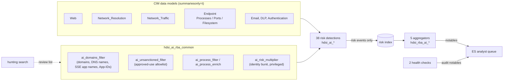

# HDSI AI RBA Content Pack for Splunk ES

**Author:** Trevor Mock, Hurricane Labs LLC

This content pack finds unsanctioned, risky and adversarial use of AI services in a Splunk Enterprise Security environment. Examples are shadow AI chat and API use, AI desktop apps, CLIs and local LLMs, coding agents and MCP servers, data uploads to AI providers, AI-themed phishing and leaked AI API keys. Each detection writes **risk only**. Only the five `hdsi_rba_ai_*` aggregators raise notables, and only when risk from several detections lands on the same person or host.

The pack ships as 47 independently deployable packages, all at version **1.1.0**, under [`saved_searches/packages/`](saved_searches/packages/):

| Role | Packages | Notable | Risk |
|---|---|---|---|
| Common macros and lookups | `hdsi_ai_rba_common` (deploy first) | n/a | n/a |
| Risk detections | 38 `hdsi_ai_*` packages | no (`action.notable = 0`) | yes (`action.risk = 1`) |
| Risk aggregators | 5 `hdsi_rba_ai_*` packages | yes (`action.notable = 1`) | no |
| Health checks | 2 `hdsi_ai_health_*` packages | audit-domain notable, no email | no |
| Hunting | `hdsi_ai_unknown_high_volume_external_api_discovery` | no | no |

Every package ships with `enable_alerting: false`. Saved-search names follow `<Domain> - HDSI AI <Title> - Rule`, and aggregators use `<Domain> - HDSI RBA AI <Title> - Rule`. The annotations cover 34 MITRE ATT&CK techniques. AI tooling acquisition is mapped to `T1588.007`.

All 46 saved searches were validated read-only against **4 production ES tenants** (Splunk Cloud 10.4–10.5, ES 8.5–8.7), called Tenant A–D below. See [Validation](#validation). Four more detections are kept unreleased in [`saved_searches/incubating/`](saved_searches/incubating/) because none of those tenants had the data to prove them on real activity (see [Incubating detections](#incubating-detections-not-released)).

---

## Architecture at a glance



- **Common package.** It resolves network evidence to an AI provider: hostnames, URLs, DNS answers (a trailing dot is tolerated), SSE/CASB app names and firewall App-IDs. It also removes approved use (per user, per system, per identity `bunit` group, or organisation-wide), resolves AI tool processes, and scales risk by identity sensitivity. It contains no saved searches. Details: [`hdsi_ai_rba_common/README.md`](saved_searches/packages/hdsi_ai_rba_common/README.md).
- **Detections.** A detection reads accelerated data models with `tstats summariesonly=t allow_old_summaries=t` and normalises the evidence. It then calls the common macros and writes risk to the `user` and/or `system` object. Every `_risk` entry carries a literal integer score, which acts as the fallback. Most detections also compute a capped `risk_score` field (marked † in the catalogue), and ES applies it to every risk object in the row. A single event stays modest (usually 10–40, never above 80), so the aggregators decide what an analyst sees. Risk objects are never the literal `unknown`, placeholders or shared hosts.
- **Aggregators.** These read `index=risk` (HDSI AI sources only) over a rolling 24 h window and raise a notable for:
  - a medium user total (`medium_risk_threshold` 60 up to below `high_risk_threshold` 90, from at least 2 detections);
  - a critical user total (90 or more);
  - risk across 3 or more of 6 AI risk vectors, at least one of them high impact;
  - a data-collection detection followed by an AI upload or exfiltration detection;
  - a privilege change followed by AI activity.
- **Health checks.**
  - `hdsi_ai_health_data_model_availability` reports a required data model that is degraded, stopped, absent or not accelerated.
  - `hdsi_ai_health_lookup_staleness_alert` reports a common lookup that is missing, empty, stale or misconfigured.

  Both raise an audit notable only when an enabled HDSI AI rule depends on the failing component.
- **Hunting.** Once a day, `hdsi_ai_unknown_high_volume_external_api_discovery` lists AI-looking services that are missing from the provider lookups. Use the list to keep `ai_provider_domains` and `ai_provider_apps` current.
- **Schedules.** 5-minute rules use `-15m@m → -5m@m`, 15-minute rules `-20m@m → -5m@m` and hourly rules `-65m@m → -5m@m`. Daily, weekly and baseline rules use `@d`-aligned windows. Every detection suppresses on its risk object field(s), normally for 24 h.

---

## Detection catalogue

**ID** is the package name, followed by its analyst runbook. The package name is also the `detection_id` that every detection writes into its risk events. **Risk** lists each risk object field with its literal `_risk` score; for example, `src` and `dest` are `system` objects. † marks a dynamic `risk_score`, followed by its cap. **Deploy** is the package's `deployment_type`:

- `global`: the rule has a data path on common ES data.
- `adhoc`: the rule needs a specific data source, documented in its README. Deploy it only where that source exists.

**Validation** summarises the read-only live runs of 2026-10-09 on Tenants A–D. Every search and drilldown parsed on all four tenants. Volumes are risk events per day, before the tenant sanctions its approved AI providers. Each package README has the full table and the copy-paste threshold SPL.

### AI service usage (network evidence)

| ID | Saved search | Data model | Risk | MITRE | Deploy | Validation |
|---|---|---|---|---|---|---|
| [`hdsi_ai_unsanctioned_web_access`](saved_searches/packages/hdsi_ai_unsanctioned_web_access/) · [AI-028](docs/runbooks/AI-028.md) | Network - HDSI AI Unsanctioned Web Access - Rule | Web | user 15, risk_src 15 † ≤30 | T1588.007 | global | Findings on A and C (SSE app names). B and D have no outbound user web data |
| [`hdsi_ai_dns_queries_to_ai_domains`](saved_searches/packages/hdsi_ai_dns_queries_to_ai_domains/) · [AI-012](docs/runbooks/AI-012.md) | Network - HDSI AI DNS Queries To AI Domains - Rule | Network_Resolution | src 10 † ≤30 | T1588.007 | global | A ~80, B ~1,500, C ~45, D 0. DNS is the most portable signal |
| [`hdsi_ai_first_seen_provider_for_user`](saved_searches/packages/hdsi_ai_first_seen_provider_for_user/) · [AI-009](docs/runbooks/AI-009.md) | Network - HDSI AI First Seen Provider For User - Rule | Web or Network_Traffic | user 20 † ≤40 | T1588.007 | global | A ~30–40; B and C ≤1; D 0 |
| [`hdsi_ai_multiple_services_in_single_session`](saved_searches/packages/hdsi_ai_multiple_services_in_single_session/) · [AI-018](docs/runbooks/AI-018.md) | Network - HDSI AI Multiple Services In Single Session - Rule | Web or Network_Resolution | user 20, src 20 † ≤40 | T1588.007 | global | A 0–2, B ~9–15; C and D 0 |
| [`hdsi_ai_new_provider_adoption_velocity`](saved_searches/packages/hdsi_ai_new_provider_adoption_velocity/) · [AI-042](docs/runbooks/AI-042.md) | Network - HDSI AI New Provider Adoption Velocity - Rule | Network_Resolution or Web | user 25, src 15 † ≤60 | T1588.007 | global | B ~3–6, C 0–1, D 0. A fails closed until Web/DNS acceleration covers 21 days |
| [`hdsi_ai_repeated_unsanctioned_access_burst`](saved_searches/packages/hdsi_ai_repeated_unsanctioned_access_burst/) · [AI-010](docs/runbooks/AI-010.md) | Network - HDSI AI Repeated Unsanctioned Access Burst - Rule | Web | user 20, src 10 † ≤50 | T1588.007 | global | Findings on A only (blocked-request bursts); B–D 0 |
| [`hdsi_ai_code_assistant_network_connection`](saved_searches/packages/hdsi_ai_code_assistant_network_connection/) · [AI-019](docs/runbooks/AI-019.md) | Network - HDSI AI Code Assistant Network Connection - Rule | Network_Traffic or Network_Resolution | src 15, user 15 † ≤50 | T1588.007 | global | A, B and C: tens to hundreds of hosts a day until approved assistants are sanctioned. D has no data path |
| [`hdsi_ai_browser_extension_activity`](saved_searches/packages/hdsi_ai_browser_extension_activity/) · [AI-021](docs/runbooks/AI-021.md) | Network - HDSI AI Browser Extension Activity - Rule | Network_Resolution or Web | src 20, user 20 † ≤60 | T1176.001, T1588.007 | global | A ~29, B ~24, C ~7, D 0 |
| [`hdsi_ai_voice_cloning_api_access`](saved_searches/packages/hdsi_ai_voice_cloning_api_access/) · [AI-045](docs/runbooks/AI-045.md) | Threat - HDSI AI Voice Cloning API Access - Rule | Web or Network_Resolution | user 20, src 20 † ≤60 | T1588.007 | global | A ~7–8, B 1–3, C 1–8, D 0 |
| [`hdsi_ai_api_access_from_non_dev_endpoint`](saved_searches/packages/hdsi_ai_api_access_from_non_dev_endpoint/) · [AI-006](docs/runbooks/AI-006.md) | Network - HDSI AI API Access From Non-Dev Endpoint - Rule | Network_Resolution, Network_Traffic or Web | src 24, user 24 † ≤50 | T1588.007, T1102, T1567 | global | A ~36, B ~5, C ~1, D 0 |
| [`hdsi_ai_access_via_vpn_proxy_evasion`](saved_searches/packages/hdsi_ai_access_via_vpn_proxy_evasion/) · [AI-022](docs/runbooks/AI-022.md) | Network - HDSI AI Access Via VPN/Proxy Evasion - Rule | Network_Traffic, Web or Network_Resolution | src 25, user 25 † ≤60 | T1090, T1090.003, T1588.007 | global | A ~40–80 (host only). B and C 0 at the default threshold. D has no data path |
| [`hdsi_ai_after_hours_service_usage`](saved_searches/packages/hdsi_ai_after_hours_service_usage/) · [AI-015](docs/runbooks/AI-015.md) | Network - HDSI AI After Hours Service Usage - Rule | Web | user 10 † ≤40 | T1567 | **adhoc** | Silent until `_utc_offset` is set. Once configured: A ~5–8, C ~2–4; B and D 0 |
| [`hdsi_ai_privileged_account_service_usage`](saved_searches/packages/hdsi_ai_privileged_account_service_usage/) · [AI-016](docs/runbooks/AI-016.md) | Identity - HDSI AI Privileged Account Service Usage - Rule | Web, Network_Traffic or Authentication | user 30 † ≤60 | T1078, T1588.007 | global | A ~3; B–D 0 |

### Data movement to AI services

| ID | Saved search | Data model | Risk | MITRE | Deploy | Validation |
|---|---|---|---|---|---|---|
| [`hdsi_ai_high_volume_upload_to_ai_service`](saved_searches/packages/hdsi_ai_high_volume_upload_to_ai_service/) · [AI-007](docs/runbooks/AI-007.md) | Network - HDSI AI High Volume Upload To AI Service - Rule | Network_Traffic or Web | src 20, user 20 † ≤80 | T1567 | global | A ~24 (firewall App-ID), C 0–1; B and D 0 |
| [`hdsi_ai_gradual_data_exfiltration_via_ai`](saved_searches/packages/hdsi_ai_gradual_data_exfiltration_via_ai/) · [AI-044](docs/runbooks/AI-044.md) | Network - HDSI AI Gradual Data Exfiltration Via AI - Rule | Network_Traffic or Web | user 25, src 25 † ≤60 | T1567, T1030 | global | Weekly. A ~23 per run; B–D 0 |
| [`hdsi_ai_personal_email_to_ai_service_upload_correlation`](saved_searches/packages/hdsi_ai_personal_email_to_ai_service_upload_correlation/) · [AI-027](docs/runbooks/AI-027.md) | Network - HDSI AI Personal Email To AI Service Upload Correlation - Rule | Web | user 35, src 15 | T1567 | global | 0 on A–D: no tenant has a byte-accurate, user-attributed proxy. The synthetic test fires |
| [`hdsi_ai_usage_following_data_access_spike`](saved_searches/packages/hdsi_ai_usage_following_data_access_spike/) · [AI-043](docs/runbooks/AI-043.md) | Endpoint - HDSI AI Usage Following Data Access Spike - Rule | Endpoint.Filesystem (+ Web / Network_Traffic) | user 40 † ≤70 | T1039, T1005, T1567 | global | A 0–1; B–D 0 (positive control OK) |
| [`hdsi_ai_copy_paste_correlation_to_ai_service`](saved_searches/packages/hdsi_ai_copy_paste_correlation_to_ai_service/) · [AI-025](docs/runbooks/AI-025.md) | Endpoint - HDSI AI Copy-Paste Correlation To AI Service - Rule | Enterprise-browser audit or DLP.DLP_Incidents | user 20, src 10 † ≤60 | T1567, T1115 | **adhoc** | A ~12–20. B–D have no paste telemetry |
| [`hdsi_ai_sanctioned_dlp_violation`](saved_searches/packages/hdsi_ai_sanctioned_dlp_violation/) · [AI-038](docs/runbooks/AI-038.md) | Audit - HDSI AI Sanctioned DLP Violation - Rule | O365 Purview audit or DLP.DLP_Incidents | user 20, src 10 † ≤45 | T1567 | global | 30-day replay: A ~0.07, C ≤1. B and D fail the package prereq searches |
| [`hdsi_ai_suspicious_model_file_exfiltration`](saved_searches/packages/hdsi_ai_suspicious_model_file_exfiltration/) · [AI-032](docs/runbooks/AI-032.md) | Threat - HDSI AI Suspicious Model File Exfiltration - Rule | Web, Network_Traffic or Endpoint.Processes | user 40, src 30 † ≤70 | T1567.001, T1567.002 | global | 0 on A–D over 7 days. The synthetic test passed |
| [`hdsi_ai_llm_model_file_download`](saved_searches/packages/hdsi_ai_llm_model_file_download/) · [AI-013](docs/runbooks/AI-013.md) | Network - HDSI AI LLM Model File Download - Rule | Web or Network_Resolution | user 30, src 30 † ≤60 | T1588.007, T1105 | global | A ~1, B ~1.4; C and D 0 |

### Behavioural baselines

| ID | Saved search | Data model | Risk | MITRE | Deploy | Validation |
|---|---|---|---|---|---|---|
| [`hdsi_ai_usage_volume_anomaly`](saved_searches/packages/hdsi_ai_usage_volume_anomaly/) · [AI-017](docs/runbooks/AI-017.md) | Network - HDSI AI Usage Volume Anomaly - Rule | Network_Traffic or Web | user 30 † ≤70 | T1567 | global | A ~2–6, C 0–1; B and D 0 |
| [`hdsi_ai_user_peer_group_usage_anomaly`](saved_searches/packages/hdsi_ai_user_peer_group_usage_anomaly/) · [AI-040](docs/runbooks/AI-040.md) | Identity - HDSI AI User Peer Group Usage Anomaly - Rule | Network_Traffic or Web | user 20 † ≤60 | T1567, T1588.007 | global | A ~9–15 before 7-day suppression; B–D 0 |
| [`hdsi_ai_time_of_day_usage_pattern_anomaly`](saved_searches/packages/hdsi_ai_time_of_day_usage_pattern_anomaly/) · [AI-041](docs/runbooks/AI-041.md) | Network - HDSI AI Time-of-Day Usage Pattern Anomaly - Rule | Web | user 15 † ≤40 | T1078, T1567 | global | A ~4; B–D 0 |

### AI tooling on endpoints

| ID | Saved search | Data model | Risk | MITRE | Deploy | Validation |
|---|---|---|---|---|---|---|
| [`hdsi_ai_unsanctioned_cli_execution`](saved_searches/packages/hdsi_ai_unsanctioned_cli_execution/) · [AI-004](docs/runbooks/AI-004.md) | Endpoint - HDSI AI Unsanctioned CLI Execution - Rule | Endpoint.Processes | user 30, src 20 | T1588.007, T1059 | global | 0 on A–D over 7 days. Synthetic: 15/15 detections, 10/10 drops |
| [`hdsi_ai_scripted_cli_invocation`](saved_searches/packages/hdsi_ai_scripted_cli_invocation/) · [AI-008](docs/runbooks/AI-008.md) | Endpoint - HDSI AI Scripted CLI Invocation - Rule | Endpoint.Processes | user 30, src 20 † ≤80 | T1059 | global | 0 on A–D over 7 days. Synthetic: 20/20 |
| [`hdsi_ai_unsanctioned_desktop_app_execution`](saved_searches/packages/hdsi_ai_unsanctioned_desktop_app_execution/) · [AI-005](docs/runbooks/AI-005.md) | Endpoint - HDSI AI Unsanctioned Desktop App Execution - Rule | Endpoint.Processes | user 20, src 20 † ≤50 | T1588.007 | global | 0 on A–D over 30 days |
| [`hdsi_ai_local_llm_framework_execution`](saved_searches/packages/hdsi_ai_local_llm_framework_execution/) · [AI-011](docs/runbooks/AI-011.md) | Endpoint - HDSI AI Local LLM Framework Execution - Rule | Endpoint.Processes | user 20, src 15 † ≤60 | T1588.007 | global | 0 on A–D over 7 days. Synthetic: 15/15 |
| [`hdsi_ai_local_llm_listening_port_detected`](saved_searches/packages/hdsi_ai_local_llm_listening_port_detected/) · [AI-014](docs/runbooks/AI-014.md) | Network - HDSI AI Local LLM Listening Port Detected - Rule | Endpoint.Ports + Endpoint.Processes | dest 30 † 30/50 | T1588.007 | global | 0 on A–D over 7 days. Synthetic: 5/5 expected hosts |
| [`hdsi_ai_agent_framework_execution`](saved_searches/packages/hdsi_ai_agent_framework_execution/) · [AI-037](docs/runbooks/AI-037.md) | Endpoint - HDSI AI Agent Framework Execution - Rule | Endpoint.Processes | user 40, src 30 | T1059, T1059.006, T1588.007 | global | 0 on A–D over 7 days. Synthetic: 7/7 |
| [`hdsi_ai_agent_autonomous_action_detection`](saved_searches/packages/hdsi_ai_agent_autonomous_action_detection/) · [AI-039](docs/runbooks/AI-039.md) | Endpoint - HDSI AI Agent Autonomous Action Detection - Rule | Endpoint.Processes | user 10, dest 10 † ≤60 | T1059, T1105, T1552, T1053 | global | C had 1 routine event in 30 days; A, B and D 0 |
| [`hdsi_ai_mcp_server_execution`](saved_searches/packages/hdsi_ai_mcp_server_execution/) · [AI-046](docs/runbooks/AI-046.md) | Endpoint - HDSI AI MCP Server Execution - Rule | Endpoint.Processes | user 30, src 20 † ≤60 | T1059, T1588.007 | global | C ~1 (host only); A, B and D 0 |
| [`hdsi_ai_assisted_lateral_movement`](saved_searches/packages/hdsi_ai_assisted_lateral_movement/) · [AI-035](docs/runbooks/AI-035.md) | Threat - HDSI AI Assisted Lateral Movement - Rule | Endpoint.Processes | user 50, src 40 (70 with offensive tooling) | T1021, T1021.002, T1021.004, T1021.006, T1047 | global | 0 on A–D (tripwire). Regex corpus: 53/53 |
| [`hdsi_ai_deepfake_tool_execution_access`](saved_searches/packages/hdsi_ai_deepfake_tool_execution_access/) · [AI-034](docs/runbooks/AI-034.md) | Endpoint - HDSI AI Deepfake Tool Execution/Access - Rule | Endpoint.Processes | user 40, src 40 † ≤80 | T1588.007 | global | 0 on A–D over 7 days |

### Adversarial AI and supply chain

| ID | Saved search | Data model | Risk | MITRE | Deploy | Validation |
|---|---|---|---|---|---|---|
| [`hdsi_ai_prompt_injection_indicators_in_web_uploads`](saved_searches/packages/hdsi_ai_prompt_injection_indicators_in_web_uploads/) · [AI-030](docs/runbooks/AI-030.md) | Threat - HDSI AI Prompt Injection Indicators In Web Uploads - Rule | Web | user 40, src 20 † ≤70 | T1204, T1204.001 | global | 0 on A–D (no pattern hits in 7 days) |
| [`hdsi_ai_generated_phishing_indicators`](saved_searches/packages/hdsi_ai_generated_phishing_indicators/) · [AI-031](docs/runbooks/AI-031.md) | Threat - HDSI AI Generated Phishing Indicators - Rule | Email.All_Email (+ Web) | user 25 † ≤60 | T1566.002, T1608.005, T1588.007 | global | A ~2–3, D <0.2. B has no Email data, and C does not map `Email.url` |
| [`hdsi_ai_api_key_exposure_in_code_dlp`](saved_searches/packages/hdsi_ai_api_key_exposure_in_code_dlp/) · [AI-033](docs/runbooks/AI-033.md) | Audit - HDSI AI API Key Exposure In Code/DLP - Rule | Endpoint.Processes | user 50, dest 30 † ≤80 | T1552, T1552.001 | global | 0 on A–D over 7 days (a high-fidelity tripwire) |
| [`hdsi_ai_compromised_plugin_extension_installation`](saved_searches/packages/hdsi_ai_compromised_plugin_extension_installation/) · [AI-036](docs/runbooks/AI-036.md) | Endpoint - HDSI AI Compromised Plugin/Extension Installation - Rule | Endpoint.Processes or Web | dest 60, user 40 | T1195.001, T1176.001, T1176.002 | global | 0 on A–D (IOC tripwire) |

### Risk aggregators (notable, no risk)

| ID | Saved search | Reads | Notable on | MITRE | Deploy | Validation |
|---|---|---|---|---|---|---|
| [`hdsi_rba_ai_user_risk_threshold_exceeded`](saved_searches/packages/hdsi_rba_ai_user_risk_threshold_exceeded/) · [AI-RISK-001](docs/runbooks/AI-RISK-001.md) | Threat - HDSI RBA AI User Risk Threshold Exceeded - Rule | risk index, `ai_detection_config` | user: medium band (60 to below 90), at least 2 detections (medium) | T1588.007 | global | 0 on A–D (no HDSI AI risk yet) |
| [`hdsi_rba_ai_user_critical_risk_threshold_exceeded`](saved_searches/packages/hdsi_rba_ai_user_critical_risk_threshold_exceeded/) · [AI-RISK-002](docs/runbooks/AI-RISK-002.md) | Threat - HDSI RBA AI User Critical Risk Threshold Exceeded - Rule | risk index, `ai_detection_config` | user: 90 or more in 24 h (high) | T1588.007 | global | 0 on A–D. The synthetic test is identical on A–D |
| [`hdsi_rba_ai_multi_vector_risk`](saved_searches/packages/hdsi_rba_ai_multi_vector_risk/) · [AI-RISK-005](docs/runbooks/AI-RISK-005.md) | Threat - HDSI RBA AI Multi-Vector Risk - Rule | risk index | user or unattributed system: 3 or more of 6 vectors, at least 1 high impact (high) | T1588.007 | global | 0 on A–D. The synthetic test passed |
| [`hdsi_rba_ai_data_collection_kill_chain`](saved_searches/packages/hdsi_rba_ai_data_collection_kill_chain/) · [AI-RISK-003](docs/runbooks/AI-RISK-003.md) | Threat - HDSI RBA AI Data Collection Kill Chain - Rule | risk index | user (or host): collection detection, then upload or exfiltration (high) | T1005, T1115, T1567 | global | 0 on A–D. Synthetic: 4/4 expected chains |
| [`hdsi_rba_ai_privilege_escalation_correlation`](saved_searches/packages/hdsi_rba_ai_privilege_escalation_correlation/) · [AI-RISK-004](docs/runbooks/AI-RISK-004.md) | Threat - HDSI RBA AI Privilege Escalation Correlation - Rule | risk index | account: privilege change, then AI activity (high) | T1098, T1134, T1548, T1567 | global | 0 on A–D. Synthetic ordering test: 5/5 |

### Health and hunting

| ID | Saved search | Reads | Output | MITRE | Deploy | Validation |
|---|---|---|---|---|---|---|
| [`hdsi_ai_health_data_model_availability`](saved_searches/packages/hdsi_ai_health_data_model_availability/) · [HEALTH-001](docs/runbooks/HEALTH-001.md) | Audit - HDSI AI Health Data Model Availability - Rule | Web, Network_Resolution, Network_Traffic, Endpoint.*, Email, DLP, Authentication | audit notable for a degraded, stopped, absent or not-accelerated model that an enabled rule needs | T1562.006 | global | 0 on A–D (no AI rule enabled yet). The synthetic absent-DLP notable fired |
| [`hdsi_ai_health_lookup_staleness_alert`](saved_searches/packages/hdsi_ai_health_lookup_staleness_alert/) · [HEALTH-002](docs/runbooks/HEALTH-002.md) | Audit - HDSI AI Health Lookup Staleness Alert - Rule | REST and common lookups | audit notable for a missing, empty, stale or misconfigured lookup | none | global | 0 on A–D. The missing-controls simulation passed |
| [`hdsi_ai_unknown_high_volume_external_api_discovery`](saved_searches/packages/hdsi_ai_unknown_high_volume_external_api_discovery/) · [AI-DISCOVERY-001](docs/runbooks/AI-DISCOVERY-001.md) | Network - HDSI AI Unknown High-Volume External API Discovery - Rule | Network_Resolution.DNS, Web | daily review list, capped at 100 rows (no risk, no notable) | T1588.007 | **adhoc** | A, B and C each hit the 100-row cap; D 0 |

### Incubating detections (not released)

These four live in [`saved_searches/incubating/`](saved_searches/incubating/), not in `packages/`, so they are not part of the release and are never deployed by default. Their logic passed synthetic tests run through the real search in Splunk, but none of Tenants A–D had the data they need, so none has fired on real activity. Each one moves to `packages/` (as `adhoc`) once it produces real results in a customer environment; [`incubating/README.md`](saved_searches/incubating/README.md) has the checklist.

| ID | Saved search | Data model | Risk | MITRE | Status | Validation |
|---|---|---|---|---|---|---|
| [`hdsi_ai_access_from_unmanaged_device`](saved_searches/incubating/hdsi_ai_access_from_unmanaged_device/) · [runbook](saved_searches/incubating/hdsi_ai_access_from_unmanaged_device/RUNBOOK.md) | Network - HDSI AI Access From Unmanaged Device - Rule | Network_Resolution | src 20 † ≤60 | T1200, T1588.007 | incubating | 0 on A–D. Needs on-network DNS plus BYOD/guest address blocks or an IP-current asset inventory |
| [`hdsi_ai_usage_from_personal_account_oauth_mismatch`](saved_searches/incubating/hdsi_ai_usage_from_personal_account_oauth_mismatch/) · [runbook](saved_searches/incubating/hdsi_ai_usage_from_personal_account_oauth_mismatch/RUNBOOK.md) | Identity - HDSI AI Usage From Personal Account / OAuth Mismatch - Rule | Authentication (+ Web / Network_Traffic) | user 20 † ≤50 | T1588.007, T1567 | incubating | 0 on A–D. Needs corporate AI SSO plus user-attributed AI traffic |
| [`hdsi_ai_browser_extension_high_volume_data_transmission`](saved_searches/incubating/hdsi_ai_browser_extension_high_volume_data_transmission/) · [runbook](saved_searches/incubating/hdsi_ai_browser_extension_high_volume_data_transmission/RUNBOOK.md) | Network - HDSI AI Browser Extension High-Volume Data Transmission - Rule | Web | src 30, user 30 † ≤60 | T1567, T1176.001 | incubating | 0 on A–D. Needs a forward proxy that logs bytes per host |
| [`hdsi_ai_dlp_violation_on_service_upload`](saved_searches/incubating/hdsi_ai_dlp_violation_on_service_upload/) · [runbook](saved_searches/incubating/hdsi_ai_dlp_violation_on_service_upload/RUNBOOK.md) | Audit - HDSI AI DLP Violation On Service Upload - Rule | DLP.DLP_Incidents | user 60, src 30 † ≤80 | T1567 | incubating | 0 on A–D: no tenant has AI-bound content DLP in the `DLP` model |

---

## Validation

All tests were read-only. They ran on 2026-10-09 against 4 production ES tenants (Splunk Cloud 10.4–10.5, ES 8.5–8.7). Each package was rendered with [`render_live_spl.py`](saved_searches/tools/render_live_spl.py) (repo macros expanded and repo lookups inlined) and run as ordinary search jobs. Nothing was deployed or written. On all four tenants, every rule and every drilldown parsed without FATAL errors.

The full before/after results, per-search row counts by tenant, expected daily risk volumes and performance notes are in [`saved_searches/reports/live_validation.md`](saved_searches/reports/live_validation.md).

The tenants differ widely in their data, and that difference drives most of the deployment advice:

| | Tenant A | Tenant B | Tenant C | Tenant D |
|---|---|---|---|---|
| Web model | NGFW URL/threat logs; `url_domain` set, `site` empty | mostly inbound load-balancer/WAF logs plus a small cloud proxy | SSE: `site` is an **app name**, `url_domain` empty | inbound IIS only |
| DNS (Network_Resolution) | on-network resolvers and a wire sensor; AI names present | cloud DNS security (roaming client); names end in a dot | cloud DNS security; AI names present | small; little AI |
| Endpoint.Processes | large | very small | large | small |
| Email / DLP | Email yes / DLP no | none / no | Email yes / DLP no | Email yes / DLP no |

No tenant's ES identities have a `department` field, so `ai_risk_multiplier` keys on `bunit`. `asset_lookup_by_str` exists in all four tenants.

What this means for a deployment:

- **DNS is the most portable AI-usage signal.**
- **Web rules must resolve SSE app names** through `ai_provider_apps`. They also must not read inbound server logs as user activity.
- **No tenant had AI-bound DLP data in the CIM `DLP` model**, so the CIM DLP upload rule is incubating. The released sanctioned-DLP rule also reads Purview audit events, which two tenants had. The CIM model is `DLP` (dataset `DLP_Incidents`), not `Data_Loss_Prevention`.
- **Endpoint AI tooling is rare today.** Those rules act as tripwires and were proven with synthetic controls.
- **The aggregators and health checks are silent everywhere** because no HDSI AI risk exists in any tenant yet. They were verified with synthetic risk sets and "real-shape" replays of existing risk.

---

## Deployment

1. **Check the prerequisites.**
   - Splunk ES 8.x.
   - The CIM data models your chosen packages declare in `data_prereqs` must be accelerated. Detections use `summariesonly=t`, so un-accelerated data is invisible to them.
   - Baseline rules read accelerated history: 15 days for `usage_volume_anomaly` and `time_of_day_usage_pattern_anomaly`, 21 days for `new_provider_adoption_velocity`, and 7 days for `gradual_data_exfiltration_via_ai`. A shorter acceleration range weakens these rules or makes them fail closed.
   - ES `identity_lookup_expanded` (`bunit`, `category`, `priority`) and `asset_lookup_by_str` / `asset_lookup_by_cidr` must be present.
2. **Deploy `hdsi_ai_rba_common` first.** It holds 8 shared macros, 10 lookups and their `transforms.conf` stanzas (`app_context: HurricaneLabsContentUpdates`). Every other package lists it in `prereq_packages`. A `| lookup` on an undefined lookup is a fatal search error, so a missing common package breaks every dependent search.
3. **Tune the common lookups before you enable anything.** The lookups are in `saved_searches/packages/hdsi_ai_rba_common/lookups/`:
   - `ai_sanctioned_entities`: load approved AI use. Keys can be per user, per system, per identity `bunit` group, or organisation-wide (`*|<provider>`), and should include API integration servers. This is the main noise control.
   - `ai_department_sensitivity`: map the tenant's real `bunit` values, or their leaf or top path segment, to risk multipliers. No tenant had a `department` field.
   - `ai_provider_apps`: add the tenant's proxy, SSE and firewall AI app names and App-IDs.
   - Opt-in rows: Microsoft 365 Copilot (`OPT_IN_M365_COPILOT`) and Gemini in Google Workspace (`OPT_IN_WORKSPACE_GEMINI`) ship `enabled=0`. After Microsoft MC1462915, `copilot.cloud.microsoft` is the Microsoft 365 home page. Enable these rows only if that use should count as AI use.
   - `ai_detection_config`: `medium_risk_threshold` (60) and `high_risk_threshold` (90) are the only rows the aggregators read. Keep medium below high.
4. **Pick the detection packages whose data exists.** `global` packages have a data path on common ES data. Deploy an `adhoc` package only when its README's data requirement is met. Run each package's README threshold SPL to set tenant values and to estimate the daily risk volume.
5. **Enable detections first, aggregators later.** Every package ships `enable_alerting: false`. Detections are risk-only and raise no notables. Turn them on once the volume is understood. After about two weeks of HDSI AI risk, enable the aggregators: the medium and critical user-threshold rules go together, with the same filter, user-key and excluded-account definitions. Then enable the health checks. Each enablement and each threshold or lookup change is a separately approved change.

---

## Tuning entry points

Tune through macros and lookups. Never edit the saved-search SPL. Each package README has a **Tuning macros** table and a **Threshold** section with copy-paste SPL.

| Entry point | Ships as | Use it for |
|---|---|---|
| `<package>_filter` | `()` | Exclusions. It sits **inline in the first `tstats where` clause** (or base search), so write it with data-model field names, for example `NOT Web.src IN ("10.1.2.3")`. Never pipe it: `\| ()` is a fatal parse error |
| `<package>_customizations` | `search *` | Post-processing after normalisation (extra filters, field overrides) |
| `<package>_risk_score` | `search *` | The last pipe of every detection. Adjust or override `risk_score` here, keeping it at 100 or below |
| `<package>_<threshold>` (for example `_min_queries`, `_zscore`, `_low_mb`, `_utc_offset`, `_excluded_providers`, `_unreliable_src`) | per package | Named thresholds, scopes and guards. They are listed in each package README |
| `ai_sanctioned_entities` (via `ai_unsanctioned_filter`) | example rows disabled | Approved AI use, shared by every network detection |
| `ai_provider_domains`, `ai_provider_apps` (via `ai_domains_filter`) | 200 domains, 105 app names / App-IDs | What counts as an AI provider, its usage type, its `severity_weight` and its traffic class (`background` hosts are down-weighted) |
| `ai_tool_processes` (via `ai_process_filter`, `ai_process_enrich`) | about 110 tools | AI CLI, desktop and local-LLM process inventory. `requires_context=1` marks colliding names |
| `ai_department_sensitivity` (via `ai_risk_multiplier`) | 11 example units | Identity sensitivity multiplier; privileged identities ×1.25; capped at 2.0 |
| `ai_detection_config` | 60 / 90 | User risk bands for the two threshold aggregators |
| `ai_prompt_injection_patterns`, `ai_api_key_patterns` | enabled rows | Pattern libraries for the adversarial detections |

Lookup changes alter what every dependent detection reports. Review them as you would a detection change.

---

## Testing

The checks below run offline against the repo. CI ([`.github/workflows/ci.yml`](.github/workflows/ci.yml)) runs validation, pytest and ruff on every push and pull request.

```bash
# Package schema, tags, dependencies (exit 0 and no output = pass)
cd saved_searches && uv run --offline --no-project --script validate.py
#   or: pip install -r saved_searches/requirements.txt && (cd saved_searches && python validate.py)

# Repository test suite: package structure, savedsearch policy, SPL references,
# lookup schemas and sync, MITRE mapping, sample events, repo hygiene
pip install -r requirements.txt
pytest tests/ -q
ruff check tests/

# Release-convention audit of all 46 saved searches (exit 0 = all conform)
saved_searches/tools/audit_savedsearch_conformance.sh [OUT_DIR]   # default report: saved_searches/reports/
```

To test a package live **without deploying it**, render it into self-contained SPL and paste the result into any ES search head:

```bash
python3 saved_searches/tools/render_live_spl.py hdsi_ai_dns_queries_to_ai_domains               # rule SPL
python3 saved_searches/tools/render_live_spl.py hdsi_ai_dns_queries_to_ai_domains --drilldowns  # plus drilldowns
python3 saved_searches/tools/render_live_spl.py --all --json --earliest -24h --latest now > batch.json
```

The renderer expands repo macros from the package and its `prereq_packages`. It inlines the common lookups as `makeresults` data and leaves ES lookups (`identity_lookup_expanded`, `asset_lookup_by_*`) and `cim_*` macros to the search head. It writes nothing to Splunk. When you test live, use read-only searches only (no `outputlookup`, `collect` or `sendalert`), prefer `tstats summariesonly=t`, and keep windows short on large tenants.

---

## Repository layout

```
saved_searches/
  packages/
    hdsi_ai_rba_common/          shared macros, transforms.conf, lookups/ (deploy first)
    hdsi_ai_<name>/              38 detections, 2 health checks, 1 hunting search
    hdsi_rba_ai_<name>/          5 risk aggregators
      package.yml                version, deployment_type, data_prereqs, tags, prereq_packages
      confs/savedsearches.conf   the saved search
      confs/macros.conf          _filter, _customizations, _risk_score and named thresholds
      README.md                  Architect Notes: prerequisites, logic, tuning, validation, deployment
  incubating/                    4 unreleased detections (same layout plus RUNBOOK.md); not deployed
  tools/                         render_live_spl.py, audit_savedsearch_conformance.sh, helpers
  validate.py, package-schema.yml, package_tags.csv
tests/                           pytest suite that validates the packages
docs/                            architecture, tuning guide, contributing, analyst runbooks
```

More documentation: [Package format](saved_searches/README.md) · [Architecture](docs/ARCHITECTURE.md) · [Tuning guide](docs/TUNING_GUIDE.md) · [Contributing](docs/CONTRIBUTING.md) · [Detection template](docs/DETECTION_TEMPLATE.md) · [Runbooks](docs/runbooks/)
