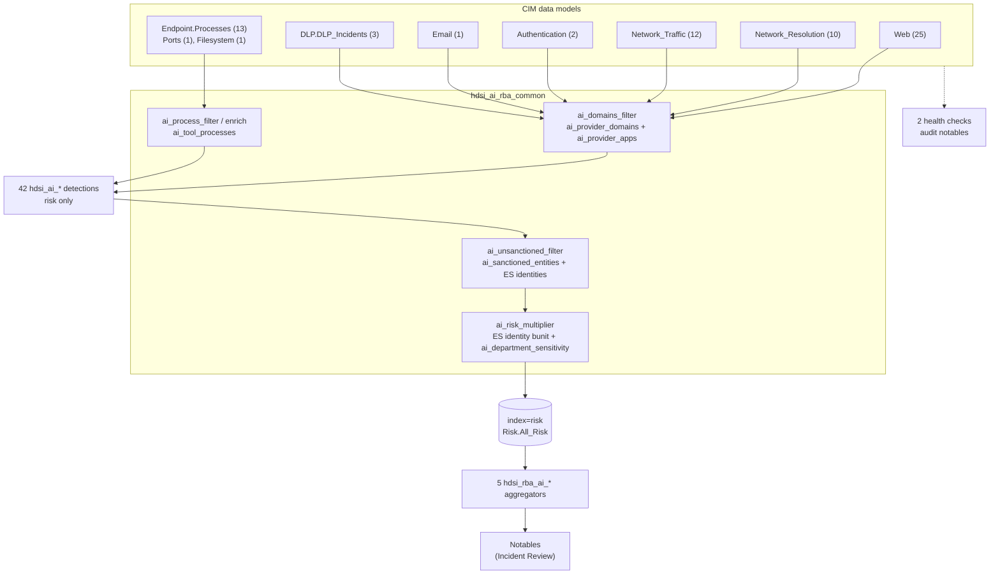
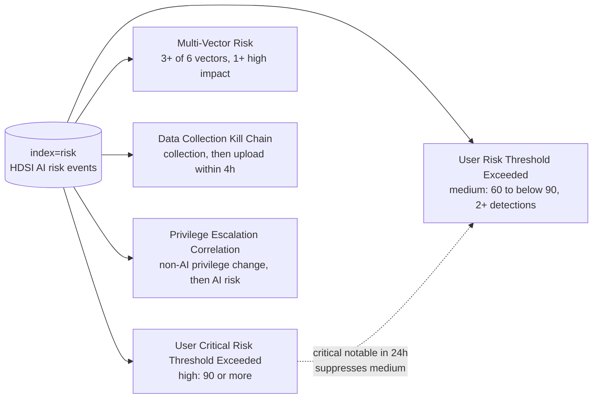
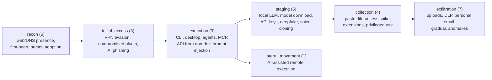

# Architecture

**Author:** Trevor Mock, Hurricane Labs LLC. Security Operations Architect

This document describes how the HDSI AI RBA content is built and how its parts fit together: the package layout, the contracts of the common package, the risk model, the aggregators that turn risk into notables, the data flow per CIM data model and the kill-chain phases. It describes the released package format under `saved_searches/packages/`. The packages are the only deployable artifact. The legacy monolithic app was retired in 1.1.0 (see the [CHANGELOG](../CHANGELOG.md)), and `tests/test_repo_hygiene.py` fails if it comes back.

Each package's `README.md` is the reference for that package's logic, tuning and live validation. This page covers what the packages share.

## Design principles

1. **Risk first, notables second.** Detections write risk on users and systems (`action.risk = 1`, `action.notable = 0`). Only the five `hdsi_rba_ai_*` aggregators raise notables, when risk from several detections or phases adds up for one entity.
2. **One package, one search.** Each detection ships as its own versioned package with its own macros and README, so a tenant deploys only what its data supports. Shared logic lives in one place, `hdsi_ai_rba_common`.
3. **Portability over elegance.** The searches were validated read-only against 4 production ES tenants (Tenant A-D; Splunk Cloud 10.4-10.5, ES 8.5-8.7) whose data differ a lot (see [Data realities](#data-realities-that-shaped-the-design)). Searches handle those differences in SPL, for example `Web.url_domain` against `Web.site`, DNS answers with a trailing dot, and identities without `department`.
4. **Fail closed on identity.** A risk object is never the literal `unknown`, empty, a placeholder (`-`, `n/a`, `Web browser`) or a shared address. Such rows are dropped, or that risk object is not emitted. A placeholder user that collects risk from 30 detections would be a false RBA hotspot.
5. **Count each piece of evidence once.** Detections avoid scoring the same evidence twice where they can. For example, `hdsi_ai_dns_queries_to_ai_domains` excludes the coding assistants that `hdsi_ai_code_assistant_network_connection` already scores. The aggregators dedupe risk events that scored both a user and a host.
6. **Everything ships inert.** Every package has `enable_alerting: false`. Enabling a rule is a separately approved, per-tenant change.

## Package roles

47 packages, plus 4 unreleased detections in `saved_searches/incubating/` (below). The test suite works out each package's role from its name and `package.yml` (`tests/conftest.py::role`). `tests/test_savedsearch_policy.py` and `saved_searches/tools/audit_savedsearch_conformance.sh` check the notable/risk policy for each role.

| Role | Packages | `action.notable` | `action.risk` | Output |
|---|---|---|---|---|
| Common | `hdsi_ai_rba_common` | n/a | n/a | Shared macros, lookups and `transforms.conf`. No saved search. Deploy first. |
| Detection | 38 `hdsi_ai_*` (36 `global`, 2 `adhoc`) | `0` | `1` | Risk events on `user` and/or `system` objects. All `action.notable.param.*` lines are kept, so a tenant can promote a rule to a notable without rewriting it. |
| Aggregator | 5 `hdsi_rba_ai_*` | `1` | `0` | Notables built from `index=risk`. No risk. |
| Health | `hdsi_ai_health_data_model_availability`, `hdsi_ai_health_lookup_staleness_alert` | `1` (security domain `audit`) | `0` | Audit notables about content health. `action.email = 0`. |
| Hunting | `hdsi_ai_unknown_high_volume_external_api_discovery` (`adhoc`) | `0` | `0` | Daily review list of AI-looking services missing from the provider registries. |

`deployment_type: adhoc` marks a detection whose data path exists in few tenants, and must be confirmed before deployment. The two adhoc detections are `after_hours_service_usage` (needs a per-tenant business-hours clock) and `copy_paste_correlation_to_ai_service` (needs browser paste audit or DLP data); both produced real results on a validation tenant once that was in place. The package README states the exact data requirement.

**Incubating (not released).** A detection that has only been proven with synthetic test events, because no validation tenant had its data, is not released. It lives in `saved_searches/incubating/<package>/` with the same layout plus its `RUNBOOK.md`, outside `packages/`, so `validate.py`, `deploy.py`, the audit and the release tests never pick it up. `tools/render_live_spl.py` still renders it for read-only tests, and `tests/test_incubating.py` checks that it keeps rendering and that no released package depends on it. The four incubating detections are `access_from_unmanaged_device`, `browser_extension_high_volume_data_transmission`, `dlp_violation_on_service_upload` and `usage_from_personal_account_oauth_mismatch`. Promotion (move the folder into `packages/` once a customer environment produces real results) is described in `saved_searches/incubating/README.md`.

## Package anatomy

```
saved_searches/packages/<package>/
  package.yml                 # version, title, description, tags, data_prereqs, prereq_packages, deployment_type
  README.md                   # Architect Notes (gold structure, see CONTRIBUTING.md)
  confs/savedsearches.conf    # exactly one correlation search
  confs/macros.conf           # <package>_filter, _customizations, _risk_score, named thresholds and lists
```

- **Stanza names.** `[<Domain> - HDSI AI <Title> - Rule]` for detections, health checks and hunting, and `[Threat - HDSI RBA AI <Title> - Rule]` for aggregators. `action.correlationsearch.label` is the stanza without the domain prefix and the ` - Rule` suffix. Domains in use are `Network`, `Endpoint`, `Identity`, `Audit` and `Threat`.
- **`detection_id`.** Every risk-writing search sets `detection_id="<package name>"`. The aggregators, the multi-vector map and `ai_mitre_mapping` all key on this value, and on the stanza name through the `source` field of risk events.
- **Version.** Every `package.yml` has `version: 1.1.0`. Every saved-search `description` starts with `v1.1.0 `, and every macro `description` starts with `v1.1 `.
- **`prereq_packages`** always includes `hdsi_ai_rba_common`. `common_dependencies` names the common macros the search calls (`macros:ai_domains_filter`, `macros:ai_unsanctioned_filter(3)` ...).

### Hook macros

Every search package defines these hooks. Their position in the SPL is fixed, and the tests check it:

| Macro | Ships as | Position |
|---|---|---|
| `<package>_filter` | `()` | **Inline** in the first `tstats ... where` clause or base search, using data model field names (`Web.user`, `DNS.src`, `Processes.dest`). It is never piped: `| ()` is a fatal parse error. |
| `<package>_customizations` | `search *` | Piped after normalisation and scoring, before the last pipe. Tenant post-processing. |
| `<package>_risk_score` | `search *` | **Last pipe** of every risk-writing search. Tenant override of `risk_score`. Not present on aggregators, health checks or hunting. |

Thresholds and lists are separate named macros (for example `hdsi_ai_dns_queries_to_ai_domains_min_queries`, `hdsi_rba_ai_multi_vector_risk_min_vectors`). Each one documents its evidence in its `description`.

## Common package contracts

`hdsi_ai_rba_common` holds no saved search. If one of its lookups is undefined, every dependent search fails with a fatal `| lookup` error, so deploy it first and keep all ten CSVs with their `transforms.conf` stanzas. Its README is the full reference. The contracts that detection authors rely on are:

| Macro | Input contract | Output contract |
|---|---|---|
| `ai_domains_filter` | Caller sets `ai_domain` (hostname, URL, DNS answer, SSE/CASB app name or App-ID), optionally `ai_input_type` = `host`/`dns` (never an app name) or `app`. **Only the first value of a multivalue field is resolved**; `mvexpand` first. | Normalises `ai_domain` (lowercase; scheme, path, `*.`, port, trailing dot and `www.` removed). Matches it exactly, then through parents with `match_subdomains=1`, then against cloud AI endpoint patterns, then against `ai_provider_apps`. Sets `provider`, `usage_type`, `severity_weight`, `ai_match`, `ai_traffic_class` (`interactive`/`background`/`site`) and keeps `enabled=1` rows only. |
| `ai_unsanctioned_filter(3)` | Field names: user, system and provider (for example `user,src,provider`). | Drops rows covered by an active `ai_sanctioned_entities` entry: user, system, group (identity `bunit`, looked up by the macro) or organisation-wide `*\|provider`. Removes its `_allow_*` working fields. |
| `ai_process_filter` | Caller creates `process_name_lc`. | `tool`, `provider`, `usage_type`, `platform`, `requires_context`. Keeps `enabled=1` rows. |
| `ai_process_enrich` | Same input. | Same outputs, every row kept. For rules that match on command line or path. |
| `ai_risk_multiplier` | Field `user`. | `risk_multiplier` = `ai_department_sensitivity` value for the identity `bunit` (whole value, then its last segment, then its first segment) x 1.25 for privileged/critical identities, capped at 2.0, plus `sensitivity_level`. `_final_multiplier` remains only as a legacy alias. |
| `ai_prompt_injection_patterns_enabled`, `ai_api_key_patterns_enabled` | Generating searches. | Enabled pattern rows, for use in a subsearch. |
| `ai_risk_defaults(1)` | `control_name`. | Optional helper. No shipped search uses it. |

| Lookup | Rows | Read by |
|---|---|---|
| `ai_provider_domains` | 200 | `ai_domains_filter`. Tstats pre-filters in Web/DNS detections are generated from it (`tests/test_lookup_sync.py` keeps them in sync). |
| `ai_provider_apps` | 105 | `ai_domains_filter` (Netskope/Zscaler/Umbrella app names, Palo Alto App-IDs). |
| `ai_tool_processes` | 109 | `ai_process_filter`, `ai_process_enrich`, process pre-filters. |
| `ai_sanctioned_entities` | 5 disabled examples | `ai_unsanctioned_filter`. |
| `ai_department_sensitivity` | 11 | `ai_risk_multiplier`. Map it to the tenant's real `bunit` values. |
| `ai_detection_config` | 26 | `medium_risk_threshold` (60) and `high_risk_threshold` (90), read by the user-risk aggregators. The other rows are deprecated and kept for the staleness check. `alert_email_to` ships empty on purpose. |
| `ai_prompt_injection_patterns`, `ai_api_key_patterns` | 25, 22 | Pattern-driven detections. |
| `ai_mitre_mapping` | 87 | Reference only, regenerated from the packages' annotations. |
| `ai_deepfake_tools` | 30 | Reference and staleness check only. |

**Provider names are join keys.** `ai_sanctioned_entities`, `provider IN (...)` exclusion macros and risk messages all compare the `provider` string. Rename a provider only together with every reference to it.

## Canonical search pipeline

Every detection follows the same order. The steps differ only in the evidence they gather:

```mermaid
flowchart LR
    A["tstats on CIM model<br/>prefilter + pkg_filter inline<br/>fillnull_value=unknown"] --> B["rename, normalise<br/>null placeholders"]
    B --> C["ai_domains_filter /<br/>ai_process_filter"]
    C --> D["aggregate per entity<br/>apply threshold macros"]
    D --> E["ai_unsanctioned_filter(3)"]
    E --> F["ai_risk_multiplier"]
    F --> G["eval risk_score<br/>min(cap, base x weight x multiplier)"]
    G --> H["detection_id, ai_activity,<br/>mitre_attack, ai_kill_chain_phase"]
    H --> I["pkg_customizations"]
    I --> J["pkg_risk_score<br/>(last pipe)"]
```



- Searches use `summariesonly=t allow_old_summaries=t` on accelerated models. The DLP rules (`sanctioned_dlp_violation`, and the incubating `dlp_violation_on_service_upload`) use `summariesonly=false`, because DLP is rarely accelerated.
- Pre-filters (`*_query_prefilter`, `*_scope`, process `IN (...)` lists) cut cost. A 1-hour Web `tstats` grouped by domain took 73 s on Tenant A unscoped and 4 s with a 7-host `IN (...)` scope (the worked example in [DETECTION_TEMPLATE.md](DETECTION_TEMPLATE.md), 2026-10-10). The DNS pre-filter cut that detection's cost per hour of data on the same tenant from about 115 s to 34 s. Pre-filters are wide on purpose; the common macros make the exact decision.
- Large DNS tables are resolved on distinct `query` values before `ai_domains_filter` (about 1.1B DNS queries a day on Tenant A).
- `append` subsearches set `maxtime` and `maxout`. Without them they truncate at 50,000 rows and finalise after 60 s without warning.

## Data flow per data model



The numbers are detections that read each model; many detections read two or three. Per model:

| Data model | What the detections take from it | Detections |
|---|---|---|
| **Web** | `url_domain` and `site` (both, because SSE proxies fill only `site` with an app name), `user`, `src`, `bytes_out/in`, `http_method`, `url`, `action`, `http_user_agent`. Group `by Web.url_domain Web.site` with `fillnull_value="unknown"`, then `ai_domain=lower(coalesce(nullif(url_domain,"unknown"),nullif(site,"unknown")))`. | 25 |
| **Network_Resolution** | `DNS.src`, `DNS.query` (trailing dot handled by the resolver), `DNS.message_type`, `DNS.vendor_product` (roaming DNS-security clients report home-router addresses as `src`; `vendor_product` identifies them). | 10 |
| **Network_Traffic** | `All_Traffic.app` (Palo Alto App-IDs resolved with `ai_input_type="app"`), `bytes_out`, `dest_port`, `user`, `src`. The firewall view of uploads and API use where Web is empty. | 12 |
| **Endpoint.Processes / Ports / Filesystem** | Process name, command line, parent and path for AI CLIs, agents, MCP servers, local LLM runtimes and offensive tooling. Ports for local LLM listeners, Filesystem for file-access spikes. | 13 / 1 / 1 |
| **Authentication** | SSO application names for AI apps (personal-account mismatch, privileged-account use). | 2 |
| **Email** | URL and recipient fields for AI-generated phishing indicators. | 1 |
| **DLP** (`DLP.DLP_Incidents`, never `Data_Loss_Prevention`) | DLP incidents whose app or destination is an AI service. No validation tenant has DLP data; `hdsi_ai_sanctioned_dlp_violation` also reads Microsoft 365 `DLPRuleMatch` events and `hdsi_ai_copy_paste_correlation_to_ai_service` reads browser paste audit events. | 3 |
| **ES identities and assets** | `identity_lookup_expanded` (`bunit`, `category`, `priority`; there is no `department` field) and `asset_lookup_by_str` / `asset_lookup_by_cidr` (`asset as <ip>` for CIDR rows). | many |

### Data realities that shaped the design

Read-only measurements over 24 h in the 4 validation tenants (2026-10-09):

| | Tenant A | Tenant B | Tenant C | Tenant D |
|---|---|---|---|---|
| Web | Firewall URL logs; `url_domain` set, `site` empty; benign categories largely not logged | Mostly inbound load-balancer/WAF logs, small proxy slice | SSE proxy; `site` = application name, `url_domain` 0% | Inbound IIS only |
| DNS | ~1.1B/day, AI present | ~53M/day, heavy AI, trailing-dot names | ~209M/day, AI present | ~2.8M/day, little AI |
| Endpoint.Processes | 174M | ~51k | 156M | 210k |
| Network_Traffic | 7.4B | 653M | 448M | 14k |
| Email | 135M | 0 | 109k | 83k |
| DLP | none | none | none | none |

So DNS is the most portable signal of AI use. Web rules must handle domain-less application names and must not treat inbound server logs as user activity. No tenant has CIM `DLP` data, so the CIM DLP upload rule is incubating; the released sanctioned-DLP rule also reads Purview audit events. Identity sensitivity is keyed on `bunit`.

## Risk model and scoring policy

### Per-event scoring

- **Static base.** Every entry in `action.risk.param._risk` carries a literal integer `risk_score` from 1 to 100. ES 8 does not substitute `$token$` values in `_risk` risk scores, so this integer is always the fallback.
- **Dynamic score.** When the SPL outputs a numeric field named exactly `risk_score`, ES uses it for **every** risk object of that row (user and system). Detections compute it as `min(<cap>, round(base_score x severity_weight x risk_multiplier))`, often with a floor (`max(5, ...)`). If one score per row does not fit a rule, it keeps static scores.
- **Inputs.** `severity_weight` comes from the provider registries (0.3 for background hosts, up to 1.2 for cloud AI APIs). `risk_multiplier` comes from `ai_risk_multiplier` (1.0 to 2.0). Detection-specific factors include a blocked-only factor of 0.5 and outcome weights.
- **Caps.** One event stays modest for a user: caps run from 30 (DNS presence, web access) to 80 (API key exposure, deepfake tooling, high-volume upload, DLP on upload, scripted CLI). Accumulation and the aggregators decide severity, not one event.
- **Field hygiene.** Fields that start with `_` are dropped from risk and notable events, so analyst text (`_risk_message`, `rule_title`, `rule_description`, drilldowns) never references `$_x$` tokens (`tests/test_savedsearch_policy.py` checks this). Use `risk_multiplier`, not `_final_multiplier`.
- **Suppression.** `alert.suppress.fields` is the risk object field(s), sometimes with the provider. The period is in seconds: `86400s` for most rules, `72000s`-`82800s` for daily rules (shorter than the 24 h cron so the next day's run is not suppressed), and 3 to 7 days (`259200s` to `604800s`) for baseline and weekly rules.

### Detection inventory

Risk objects show the field and the static base score. "Cap" is the upper bound of the SPL `risk_score`; "dynamic" means the score is computed without a single numeric cap (tiers or per-category values), and "static" means no `risk_score` field is computed.

| Package (`hdsi_ai_` prefix omitted) | Data models | Phase | Risk objects (base) | Score | Schedule | Type |
|---|---|---|---|---|---|---|
| `access_from_unmanaged_device` | Network_Resolution | initial_access | system:src 20 | cap 60 | hourly | incubating (not released) |
| `access_via_vpn_proxy_evasion` | Network_Resolution, Network_Traffic, Web | initial_access | system:src 25, user 25 | cap 60 | hourly | global |
| `after_hours_service_usage` | Web | exfiltration | user 10 | cap 40 | hourly | adhoc |
| `agent_autonomous_action_detection` | Endpoint.Processes | execution | user 10, system:dest 10 | dynamic | hourly | global |
| `agent_framework_execution` | Endpoint.Processes | execution | user 40, system:src 30 | static | 15 min | global |
| `api_access_from_non_dev_endpoint` | Network_Resolution, Network_Traffic, Web | execution | system:src 24, user 24 | cap 50 | daily | global |
| `api_key_exposure_in_code_dlp` | Endpoint.Processes | staging | user 50, system:dest 30 | cap 80 | 15 min | global |
| `assisted_lateral_movement` | Endpoint.Processes | lateral_movement | user 50, system:src 40 | dynamic | 5 min | global |
| `browser_extension_activity` | Network_Resolution, Web | collection | system:src 20, user 20 | cap 60 | hourly | global |
| `browser_extension_high_volume_data_transmission` | Web | exfiltration | system:src 30, user 30 | cap 60 | hourly | incubating (not released) |
| `code_assistant_network_connection` | Network_Resolution, Network_Traffic | execution | system:src 15, user 15 | cap 50 | daily | global |
| `compromised_plugin_extension_installation` | Endpoint.Processes, Web | initial_access | system:dest 60, user 40 | static | 15 min | global |
| `copy_paste_correlation_to_ai_service` | DLP (+ browser paste audit events) | collection | user 20, system:src 10 | cap 60 | hourly, 20 min lag | adhoc |
| `deepfake_tool_execution_access` | Endpoint.Processes | staging | user 40, system:src 40 | cap 80 | 15 min | global |
| `dlp_violation_on_service_upload` | DLP | exfiltration | user 60, system:src 30 | cap 80 | hourly | incubating (not released) |
| `dns_queries_to_ai_domains` | Network_Resolution | recon | system:src 10 | cap 30 | daily | global |
| `first_seen_provider_for_user` | Network_Traffic, Web | recon | user 20 | cap 40 | daily | global |
| `generated_phishing_indicators` | Email, Web | initial_access | user 25 | cap 60 | hourly | global |
| `gradual_data_exfiltration_via_ai` | Network_Traffic, Web | exfiltration | user 25, system:src 25 | cap 60 | weekly (7 days) | global |
| `high_volume_upload_to_ai_service` | Network_Traffic, Web | exfiltration | system:src 20, user 20 | cap 80 | hourly | global |
| `llm_model_file_download` | Network_Resolution, Web | staging | user 30, system:src 30 | cap 60 | daily | global |
| `local_llm_framework_execution` | Endpoint.Processes | staging | user 20, system:src 15 | cap 60 | hourly | global |
| `local_llm_listening_port_detected` | Endpoint.Ports, Endpoint.Processes | staging | system:dest 30 | dynamic | hourly | global |
| `mcp_server_execution` | Endpoint.Processes | execution | user 30, system:src 20 | cap 60 | 15 min | global |
| `multiple_services_in_single_session` | Network_Resolution, Web | recon | user 20, system:src 20 | dynamic | hourly | global |
| `new_provider_adoption_velocity` | Network_Resolution, Web | recon | user 25, system:src 15 | dynamic | daily (21-day baseline) | global |
| `personal_email_to_ai_service_upload_correlation` | Web | exfiltration | user 35, system:src 15 | static | hourly | global |
| `privileged_account_service_usage` | Authentication, Network_Traffic, Web | collection | user 30 | cap 60 | hourly | global |
| `prompt_injection_indicators_in_web_uploads` | Web | execution | user 40, system:src 20 | cap 70 | hourly | global |
| `repeated_unsanctioned_access_burst` | Web | recon | user 20, system:src 10 | dynamic | 15 min | global |
| `sanctioned_dlp_violation` | DLP (+ Microsoft 365 DLP events) | exfiltration | user 20, system:src 10 | cap 45 | hourly | global |
| `scripted_cli_invocation` | Endpoint.Processes | execution | user 30, system:src 20 | cap 80 | hourly | global |
| `suspicious_model_file_exfiltration` | Endpoint.Processes, Network_Traffic, Web | exfiltration | user 40, system:src 30 | cap 70 | hourly | global |
| `time_of_day_usage_pattern_anomaly` | Web | exfiltration | user 15 | cap 40 | daily (15-day baseline) | global |
| `unsanctioned_cli_execution` | Endpoint.Processes | execution | user 30, system:src 20 | static | 15 min | global |
| `unsanctioned_desktop_app_execution` | Endpoint.Processes | execution | user 20, system:src 20 | cap 50 | hourly | global |
| `unsanctioned_web_access` | Web | recon | user 15, system:risk_src 15 | cap 30 | hourly | global |
| `usage_following_data_access_spike` | Endpoint.Filesystem, Network_Traffic, Web | collection | user 40 | cap 70 | hourly | global |
| `usage_from_personal_account_oauth_mismatch` | Authentication, Network_Traffic, Web | exfiltration | user 20 | dynamic | daily | incubating (not released) |
| `usage_volume_anomaly` | Network_Traffic, Web | exfiltration or execution | user 30 | cap 70 | daily (15-day baseline) | global |
| `user_peer_group_usage_anomaly` | Network_Traffic, Web | collection or exfiltration | user 20 | cap 60 | daily | global |
| `voice_cloning_api_access` | Network_Resolution, Web | staging | user 20, system:src 20 | cap 60 | daily | global |

## Aggregators: how risk becomes a notable

All five aggregators read `index=risk` over a rolling 24 hours and write no risk. They select HDSI AI risk by `source="* - HDSI AI * - Rule"` and/or `detection_id="hdsi_ai_*"`, exclude the health checks, and normalise entities before counting. Each has `_filter` (inline in the base search) and `_customizations` hooks but no `_risk_score`.



| Aggregator | Entity | Fires when | Severity | Schedule / suppression |
|---|---|---|---|---|
| `hdsi_rba_ai_user_risk_threshold_exceeded` | Person: `user_key` merges UPN, `DOMAIN\user` and bare forms; built-in, machine (`*$`), service and placeholder accounts excluded | 24 h total in `[medium_risk_threshold, high_risk_threshold)` (60 to below 90) **and** at least 2 distinct detections (`_min_detections`), and no critical notable for the same `user_key` in the last 24 h | medium | every 15 min; `user_key` for 86400s |
| `hdsi_rba_ai_user_critical_risk_threshold_exceeded` | Same `user_key` normalisation | 24 h total at or above `high_risk_threshold` (90) from at least 1 detection | high | every 15 min (offset 12); `user_key` for 86400s |
| `hdsi_rba_ai_multi_vector_risk` | User (with hosts attributed only to that user merged in) or unattributed system | Risk across at least 3 of the 6 vectors (`_min_vectors`), at least 1 high-impact vector (`data_exposure`, `risky_access`, `adversarial`), and a vector first indexed in the last 65 minutes (rising edge) | high | every 15 min; `risk_object_key, risk_object_type, vector_count` for 86400s, so a new vector raises a new notable |
| `hdsi_rba_ai_data_collection_kill_chain` | User, or system when no user is attributed | A collection detection followed within 4 h (`_window_hours`, 60 min ordering tolerance) by an upload/exfiltration detection | high | hourly; `entity_type, entity` for 86400s |
| `hdsi_rba_ai_privilege_escalation_correlation` | User (bare account name) | Risk from a **non-AI** privilege-change rule (ATT&CK T1068, T1134, T1484, T1548, T1611, T1098.002/.003/.007, or a rule-name match), then AI risk of at least 20 in the execution, staging, collection, exfiltration or lateral-movement phase whose activity time is at or after the change (ordering fails closed) | high | hourly; `risk_entity` for 86400s |

The two threshold rules split the user total into non-overlapping bands, so one user total never raises both. Tune the bands in `ai_detection_config`, not in the searches. The lookup staleness health check reports a band that is empty or inverted.

### Multi-vector map

`hdsi_rba_ai_multi_vector_risk_vector_map` assigns every detection to one vector. Detections that the map does not list fall back to their `ai_kill_chain_phase`:

| Vector | Detections |
|---|---|
| `shadow_usage` | unsanctioned_web_access, first_seen_provider_for_user, repeated_unsanctioned_access_burst, multiple_services_in_single_session, new_provider_adoption_velocity, dns_queries_to_ai_domains, api_access_from_non_dev_endpoint, code_assistant_network_connection |
| `usage_anomaly` | after_hours_service_usage, time_of_day_usage_pattern_anomaly, usage_volume_anomaly, user_peer_group_usage_anomaly |
| `local_tooling` | unsanctioned_cli_execution, unsanctioned_desktop_app_execution, scripted_cli_invocation, local_llm_framework_execution, local_llm_listening_port_detected, agent_framework_execution, mcp_server_execution, llm_model_file_download, browser_extension_activity; agent_autonomous_action_detection for ordinary agent activity |
| `risky_access` (high impact) | access_via_vpn_proxy_evasion, privileged_account_service_usage; incubating: access_from_unmanaged_device, usage_from_personal_account_oauth_mismatch |
| `data_exposure` (high impact) | high_volume_upload_to_ai_service, sanctioned_dlp_violation, personal_email_to_ai_service_upload_correlation, gradual_data_exfiltration_via_ai, copy_paste_correlation_to_ai_service, usage_following_data_access_spike, suspicious_model_file_exfiltration, api_key_exposure_in_code_dlp; incubating: dlp_violation_on_service_upload, browser_extension_high_volume_data_transmission |
| `adversarial` (high impact) | prompt_injection_indicators_in_web_uploads, generated_phishing_indicators, deepfake_tool_execution_access, voice_cloning_api_access, compromised_plugin_extension_installation, assisted_lateral_movement; agent_autonomous_action_detection when the action category is credential access, persistence or system change |

The unknown-API hunting report and the health checks map to no vector. The incubating detections stay in the map so that they count correctly if they are promoted; while they are not deployed they contribute nothing.

### Kill-chain aggregator lists

- **Collection:** copy_paste_correlation_to_ai_service, usage_following_data_access_spike, browser_extension_activity.
- **Upload/exfiltration:** high_volume_upload_to_ai_service, gradual_data_exfiltration_via_ai, sanctioned_dlp_violation, personal_email_to_ai_service_upload_correlation, suspicious_model_file_exfiltration; also the incubating dlp_violation_on_service_upload and browser_extension_high_volume_data_transmission.

Both lists are macros (`_collection_detections`, `_exfil_detections`). Add a new detection to them only if its evidence really is staging or upload of data.

## Kill-chain phases

Every risk-writing detection sets `ai_kill_chain_phase`. The counts below are released detections only. The privilege-escalation aggregator filters on it, multi-vector uses it as a fallback, and analysts read it in risk events.



`usage_volume_anomaly` (exfiltration when the bytes-out baseline is broken, otherwise execution) and `user_peer_group_usage_anomaly` (collection for a request-count outlier, otherwise exfiltration) set the phase per result. MITRE ATT&CK techniques live in each search's `action.correlationsearch.annotations` (1 to 4 IDs by convention, current ATT&CK; AI tooling acquisition is `T1588.007`), and the SPL `mitre_attack` eval matches them. `ai_mitre_mapping.csv` is regenerated from those annotations, and `tests/test_mitre_coverage.py` keeps the two consistent.

## Scheduling

| Cadence | Cron / dispatch | Used by |
|---|---|---|
| 5 min | `2-59/5 * * * *`, `-15m@m` to `-5m@m` | lateral movement |
| 15 min | `N-59/15 * * * *`, `-20m@m` to `-5m@m` | process and burst rules |
| Hourly | `M * * * *`, `-65m@m` to `-5m@m` (DLP paste: `-80m@m` to `-20m@m` for ingest lag) | most Web, DNS, Network and process rules |
| Daily | fixed minute between 01:00 and 05:00, `-1d@d` to `@d` (baselines `-15d@d`/`-21d@d`, weekly `-7d@d`) | DNS presence, first-seen, adoption velocity, anomalies, code assistants, voice cloning |
| Aggregators | every 15 min or hourly, `-24h` to `now` | `hdsi_rba_ai_*` |
| Health | hourly (data models, last 7 days to `-1h@h`), daily 09:15 (lookups) | `hdsi_ai_health_*` |

Every window ends at `-5m@m` or `@d` so indexing lag does not drop events. Minute offsets are spread so that rules do not all start on the same minute.

## Health and hunting

- **`hdsi_ai_health_data_model_availability`** compares the last 2 complete hours of each model the detections read with the median of the same hours over the previous 6 days. It reports `OK`, `DEGRADED`, `STOPPED`, `ABSENT` or `NOT_ACCELERATED`, and raises an audit notable only for a model that an enabled detection depends on.
- **`hdsi_ai_health_lookup_staleness_alert`** reports missing lookup definitions (fatal for dependents), curated lists with no enabled rows, a missing or inverted threshold band, curated lists not reviewed in 90 days, and sanctioned entries that have expired or expire within 14 days.
- **`hdsi_ai_unknown_high_volume_external_api_discovery`** lists AI-looking services (AI URL categories, AI product words, `.ai` TLD) seen in DNS and Web data that are not yet in the registries. Review it to keep `ai_provider_domains` and `ai_provider_apps` current. Those registries decide what every Web and DNS detection can see.

## Deployment order

1. `hdsi_ai_rba_common`. Map `ai_department_sensitivity` to the tenant's `bunit` values, load sanctioned use into `ai_sanctioned_entities` (including organisation-wide `*|<provider>` keys), add the tenant proxy's application names to `ai_provider_apps`, and decide on the opt-in rows (Microsoft 365 Copilot, Gemini for Workspace).
2. The health checks, to confirm which data models are populated and accelerated.
3. Detections whose `data_prereqs` the tenant meets. Validate each one read-only first (see [CONTRIBUTING.md](CONTRIBUTING.md#4-live-test-it-read-only)).
4. The aggregators, once the detections have produced risk for long enough to measure the 24 h user totals.

Every package ships `enable_alerting: false`. Each enablement, and each lookup change that alters what the detections report, is a separately approved change. Day-2 tuning is in [TUNING_GUIDE.md](TUNING_GUIDE.md) and in each package README.
